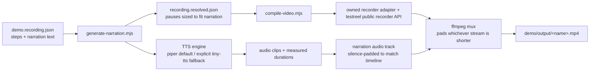

# Reference: demo-video pipeline

## Prerequisites

- Node.js ≥ 20 (required by `testreel`).
- Python 3 (just the interpreter - `venv` and `pip` come with it), for Piper, alignment, OCR, and native desktop automation. TinyTTS can be selected explicitly when Python is unavailable.
- Everything else - npm packages, the Chromium browser, the Python venv, voice models - is installed automatically into `~/.demo_video` the first time `bootstrap.mjs` runs. Nothing to install by hand, and nothing touches the project.

## Isolated environment (`~/.demo_video`)

Nothing this skill needs - npm packages, the Chromium browser, the Python venv, downloaded voice models, or any per-run cache - ever touches the project you're generating a video for, or that project's own tooling (`node_modules`, `package.json`, `.venv`). It all lives under `~/.demo_video`, anchored to the user's home directory via Node's `os.homedir()` - deliberately *not* relative to the project, and *not* relative to wherever this skill itself happens to be installed (project-level `.claude/skills/` vs personal `~/.claude/skills/`). That means a single isolated install is shared across every project on the machine that uses this skill.

```
~/.demo_video/
├── package.json, node_modules/ - testreel, playwright, tiny-tts, ffmpeg-static, ffprobe-static
├── browsers/ - Chromium, via PLAYWRIGHT_BROWSERS_PATH (never Playwright's default shared cache)
├── .demovideo_venv/ - isolated Python venv for Piper
├── .demovideo_voices/ - downloaded Piper voice models
├── .demovideo_align_venv/ - isolated faster-whisper environment
├── .demovideo_align_models/ - word-alignment model cache
├── .demovideo_ocr_venv/ - isolated OCR and perceptual-image environment
├── scripts/ - this skill's pipeline scripts, kept in sync by bootstrap.mjs
└── cache/<project-hash>/<flow>/ - per-run intermediates (audio clips, resolved definitions, raw video before muxing)
```

**`bootstrap.mjs`** (`scripts/lib/npm-env.mjs` does the actual work) keeps the npm/browser side in sync. Always run it via its original bundled location (`${CLAUDE_SKILL_DIR}/scripts/bootstrap.mjs`), never via the copy it creates at `~/.demo_video/scripts/bootstrap.mjs` - it locates its sibling files relative to its own path specifically so it can sync them forward, and it detects and safely no-ops if it's ever run from the already-synced location instead. Each run:
- Always re-copies `scripts/` into `~/.demo_video/scripts/`, so a skill update is picked up on the very next run without any manual cache-clearing.
- Only runs `npm install` if a required package is missing from `~/.demo_video/node_modules/` - cheap existence checks, not a version audit.
- Only runs `npx playwright install chromium` if no `chromium-*` folder exists yet under `~/.demo_video/browsers/`.

**Browser discovery:** the bundled compiler sets `PLAYWRIGHT_BROWSERS_PATH` before dynamically importing browser modules. Custom scripts should set it before importing Playwright or testreel; changing it after import is too late.

**Per-project cache isolation:** intermediate files (synthesized clips, the resolved recording definition, silence padding, the raw pre-mux video) are namespaced under `cache/<hash>/`, where `<hash>` is a short SHA of the project's absolute path - so two different projects sharing this same isolated install never collide, even though the tooling itself is shared. A `.project-path` marker file sits alongside each hash for human debugging.

### Isolated Python environment for Piper

Piper specifically also gets its own self-healing lifecycle (`scripts/lib/piper-venv.mjs`), separate from the npm/browser side above because a venv has different failure modes than an npm install - checked once per process (cached for the rest of that run, so a single `generate-narration.mjs` invocation with many narrated steps only checks once, not once per clip):

| State | Detection | Action |
|---|---|---|
| Missing | `.demovideo_venv` directory doesn't exist | `python3 -m venv` + `pip install piper-tts` |
| Corrupted | The venv's `piper` binary is missing, or `piper --help` fails to even run (e.g. a stale interpreter symlink after a system Python upgrade) | Delete the whole venv and recreate it from scratch - no amount of `pip install` reliably fixes a broken interpreter, so a full rebuild is the only dependable repair |
| Outdated | `pip show piper-tts` reports a version below this skill's minimum | `pip install --upgrade` in place, no full rebuild needed |
| Healthy | None of the above | Used as-is, no action taken |

This has been verified against a live environment, including deliberately deleting the `piper` binary to confirm the corruption path rebuilds correctly, and deliberately installing an old version to confirm the update path upgrades in place rather than doing a full (slower) rebuild.

If `python3` isn't on `PATH`, `piper-venv.mjs` also tries plain `python` before giving up (some Windows setups only expose the latter).

## Architecture



## Recording definition schema

Only `url` and `steps` are required by the owned recorder adapter. `narration` is a pipeline field used for audio, timing, and captions.

Root-level options worth knowing (full list at `node_modules/testreel/dist/docs/recording-definitions.md` once installed): `viewport`, `outputSize`, `outputFormat` (`mp4`/`gif`/`webm`), `colorScheme`, `speed`, `cursor` (style/size/color), `chrome` (macOS-style window chrome), `background` (padding/color/gradient), `storageState`/`cookies`/`localStorage`/`setup` (auth flows).

### Polished browser presentation baseline

The starter definition uses the presentation settings that produced the established TruAris tutorial style:

| Setting | Default | Purpose |
|---|---|---|
| Browser viewport | `1920x1080` | Captures dense application screens without cramped controls |
| Output | `2560x1440` | Produces a crisp QHD master for client delivery |
| Background | `#0b1020` with 32 px padding | Frames the product as a presentation rather than a raw capture |
| Corners | 16 px | Separates the application window from the stage |
| Window chrome | Descriptive title | Keeps context visible without exposing a long URL |
| Cursor | Pointer at size 42 | Makes interactions easy to follow at QHD resolution |
| Encoder | `libx264` | Preserves small interface text and gradients consistently |
| Focus zoom | 1.3x to 1.5x | Directs attention to controls and results before returning to 1x |

Adjust the viewport when the product layout requires another breakpoint, but retain the stage, border, cursor, focus motion, and QHD master unless the user requests another visual format.

Step actions: `wait`, `click`, `clickResponse`, `type`, `fill`, `clear`, `upload`, `check`, `uncheck`, `select`, `scroll`, `hover`, `keyboard`, `navigate`, `screenshot`, `zoom`, `waitForNetwork`, `assert`, and `if`, plus `hideCursor`/`showCursor`. `selector` accepts any Playwright selector (CSS, `text=`, `role=`, XPath).

`upload` is implemented by the owned recorder adapter. It accepts `selector` for an `<input type="file">`, `files` as one absolute path or an array of absolute paths, and an optional `visualSelector` for the visible Choose file button or dropzone. The input may be hidden; the action waits for it to be attached, animates the cursor and ripple over `visualSelector`, then calls Playwright `setInputFiles`. Example:

```json
{
 "action": "upload",
 "selector": "input[type=file]",
 "visualSelector": "button:has-text(\"Choose file\")",
 "files": "${IMPORT_FILE}",
 "narration": "Choose the exported workbook and attach it to this import."
}
```

### State-aware actions and assertions

These actions run in both the renderer and `verify-steps.mjs`:

```json
[
 { "action": "check", "selector": "#include-orders" },
 { "action": "assert", "selector": "#include-orders", "kind": "checked" },
 {
 "action": "clickResponse",
 "selector": "button[type=submit]",
 "urlPattern": "/imports/orders",
 "method": "POST",
 "status": 202
 },
 { "action": "assert", "selector": "text=Processing", "kind": "visible" }
]
```

`assert.kind` supports `text`, `count`, `visible`, `hidden`, `enabled`, `disabled`, `checked`, `unchecked`, and `value`. Count assertions accept `equals`, `min`, and `max`. Text assertions accept `text` for containment or `equals` for exact trimmed text.

Conditional actions use a runtime DOM condition and nested action lists:

```json
{
 "action": "if",
 "condition": { "selector": "#email", "state": "visible" },
 "then": [
 { "action": "fill", "selector": "#email", "text": "${DEMO_EMAIL}" },
 { "action": "fill", "selector": "#password", "text": "${DEMO_PASSWORD}" },
 { "action": "click", "selector": "button[type=submit]" }
 ],
 "else": [{ "action": "assert", "selector": "text=Dashboard", "kind": "visible" }]
}
```

Condition states are `visible` (default), `attached`, `checked`, `enabled`, and `text`. Set `not: true` to invert the result. Nested actions may include another `if`.

### Automatic authentication refresh

`authRefresh` validates a stored browser session and rebuilds it when missing, older than `maxAgeMinutes`, redirected to a rejected URL, or missing the validation selector:

```json
{
 "storageState": "C:/demo/auth-state.json",
 "authRefresh": {
 "url": "${DEMO_BASE_URL}/login",
 "storageState": "C:/demo/auth-state.json",
 "maxAgeMinutes": 45,
 "rejectUrlPattern": "/login",
 "validateSelector": "text=Dashboard",
 "readyUrlPattern": "/dashboard",
 "steps": [
 { "action": "fill", "selector": "#email", "text": "${DEMO_EMAIL}" },
 { "action": "fill", "selector": "#password", "text": "${DEMO_PASSWORD}" },
 { "action": "click", "selector": "button[type=submit]" }
 ]
 }
}
```

Refresh steps intentionally support only login-safe actions: `fill`, `click`, `check`, `uncheck`, `keyboard`, and `wait`.

### Evidence manifest

Evidence entries turn required screens and values into a checked manifest. `afterStep` is a zero-based step index; omit it or use `final` for the end state.

```json
{
 "quality": { "requireEvidence": true },
 "evidence": [
 {
 "name": "completed-bulk-results",
 "afterStep": 6,
 "selector": "tbody tr",
 "minCount": 10,
 "state": "visible"
 },
 {
 "name": "terminal-status",
 "selector": "text=COMPLETED",
 "text": "COMPLETED"
 }
 ]
}
```

The verifier stores screenshots plus `evidence-report.json` in the per-project cache. The report includes a hash of the recording definition, so changing the definition invalidates earlier evidence.

### OCR and visual evidence

DOM evidence proves that an element existed during the dry run. Visual evidence proves that the final encoded frame contains the required words or reviewed visual state. Set `quality.visualEvidence` to a JSON file relative to the recording definition:

```json
[
 {
 "name": "completed-import-count",
 "timestamp": 212.4,
 "expectedText": ["324", "COMPLETED"],
 "crop": { "x": 180, "y": 90, "width": 1100, "height": 500 }
 },
 {
 "name": "approved-settings-layout",
 "timestamp": 418.2,
 "referenceImage": "evidence/settings-reference.png",
 "minimumSimilarity": 0.9
 }
]
```

The first run creates `~/.demo_video/.demovideo_ocr_venv` and installs RapidOCR, ONNX Runtime, and Pillow. The verifier extracts a PNG at each timestamp, optionally crops it, runs OCR, computes a 16 by 16 luminance hash, and writes `visual-evidence-report.json` plus the inspected frames. OCR matching is case-insensitive and punctuation-insensitive. Reference-image comparison is suited to layout and framing checks, not pixel-perfect animation matching.

`compact-silence.mjs` uses SRT cue boundaries as the narration authority. Narrated spans remain at normal speed. Gaps are accelerated up to the selected factor while retaining the configured minimum visible gap. The script re-encodes the video and writes a retimed SRT from the same piecewise mapping. Use it only after the full merged MP4 and SRT pass their ordinary checks.

`reflow-subtitles.mjs` converts long narration cues into phrase-level closed captions. It limits word count and line length, balances each phrase across at most two lines, and distributes the original cue interval proportionally across the smaller captions. Run it after merging, insertion, compaction, or any other operation that changes subtitle timestamps.

`align-subtitles.mjs` is the preferred caption path when timing precision matters. It uses faster-whisper word timestamps in a dedicated `~/.demo_video/.demovideo_align_venv`. With `--source-srt`, a longest-common-subsequence alignment keeps approved transcript wording while using detected words as time anchors and interpolating only unmatched words. The model is downloaded once and cached by Hugging Face outside the project.

### Fast patching and rendering

`patch-video.mjs` accepts a JSON overlay list and applies every image patch in one encode:

```json
{
 "encoder": "auto",
 "overlays": [
 { "path": "C:/captures/completed.png", "start": 209, "end": 211 },
 { "path": "C:/captures/results.png", "start": 226, "end": 228 }
 ]
}
```

Overlay entries also accept `x` and `y`. The helper preserves the original audio stream and fixes the output duration to the input duration, even though looped still-image inputs are infinite.

`patch-video-gop.mjs` uses the same logical overlay fields with `image`, `start`, `end`, `x`, `y`, and optional `width` and `height`. It discovers source keyframes, expands each correction to the enclosing GOP, merges overlapping windows, stream-copies untouched intervals, encodes only repair windows, and concatenates the segments. It requires H.264 input because copied and encoded segments must share a compatible stream. The command prints encoded and copied durations so the optimization is visible in logs.

Encoder selection probes the hardware instead of trusting ffmpeg's encoder list. `auto` tries NVENC, Quick Sync, AMF, or VideoToolbox where appropriate, then falls back to `libx264`. The compiler reads `quality.encoder`; patch and compact helpers accept `--encoder`; all three honor `DEMO_VIDEO_ENCODER` where no explicit value is supplied. Use `libx264` for deterministic software output.

Set `quality.cacheVisualCapture: true` to opt into visual caching. The cache key excludes narration text and narration configuration but includes resolved step timing, selectors, layout, and actions. A capture is stored only after blank/loading QA passes. This makes voice or mux iterations fast without re-running browser mutations.

`narrationConfig` (custom field, read by `generate-narration.mjs`):

| Field | Default | Meaning |
|---|---|---|
| `engine` | `"piper"` | `"piper"` or `"tiny-tts"` |
| `fallbackEngine` | `null` | Explicit `"tiny-tts"` allows fallback; otherwise Piper failures stop synthesis |
| `cacheNarration` | `true` | Reuse clips with matching speech and voice settings; false forces synthesis |
| `piperVoice` | `"en_US-ryan-medium"` | Piper voice name (male, US English); model auto-downloads on first use |
| `piperModel` | - | Explicit path to a `.onnx` file, skips auto-download |
| `piperSpeaker` | - | Numeric speaker ID, only relevant for multi-speaker Piper voices |
| `speaker` | `"MALE"` | tiny-tts speaker (`"MALE"`/`"FEMALE"`) - used only if it falls back to tiny-tts |
| `speed` | `1.0` | Speech rate |
| `bufferMs` | `450` | Breathing room added after each narration clip |
| `actionOverheadMs` | `400` | Rough estimate of click/hover animation time; used only to place a clip's silent lead-in, never truncates audio |
| `initialSilenceMs` | `0` | Optional narration lead-in for a known opening pause; captured page loading is trimmed automatically during compile |
| `finalSilenceMs` | `0` | Optional trailing narration silence for a measured encoder/page tail that cannot be represented by an action |
| `venvDir` | - | Explicit override for the isolated venv's location, bypassing the `~/.demo_video`-based default entirely |
| `pronunciations` | built-in technical terms | Object mapping displayed terms to speech-friendly spellings; caption text remains unchanged |
| `pronunciationFile` | none | JSON pronunciation object relative to the recording definition |
| `maxSentenceWords` | `28` | Narration lint threshold for sentence length |
| `strictNarration` | `false` | Fail synthesis when lint finds long sentences or unknown acronyms |
| `audioMastering` | `true` | Apply high-pass, low-pass, speech compression, loudness normalization, and limiting |
| `audioMasteringFilter` | built-in speech chain | Advanced FFmpeg filter override for project-specific mastering |
| `voiceCandidates` | `[]` | Candidate overrides tested on one short calibration passage; fewer than two disables selection |
| `voiceSelection.mode` | `"cached-asr"` | `"fast"` uses acoustic checks, `"cached-asr"` adds ASR only when already cached, and `"verified"` permits ASR setup/download |
| `voiceSelection.sampleText` | derived | Stable project calibration text; recommended when several recording parts share one voice |
| `voiceSelection.sampleWords` | `42` | Maximum derived calibration length when `sampleText` is omitted |
| `voiceSelection.asrModel` | `"tiny.en"` | Faster-whisper model used for short pronunciation scoring |

Steps may include `framingSelectors`, which the structural verifier reads and testreel ignores. Each entry is a selector string or `{ "selector": "...", "minVisibleRatio": 0.85 }`. Use it on narrated steps to prove that the claimed UI is inside the viewport. A section taller than the viewport needs multiple framing steps across its top, middle, and bottom.

The optional root `quality` object supports:

| Field | Default | Meaning |
|---|---|---|
| `trimLeadingLoading` | `true` | Detect and remove low-information startup frames captured before the target page is ready |
| `contentEdgeAverage` | `1.5` | Advanced edge-density threshold for meaningful initial content |
| `stableContentMs` | `500` | Meaningful content must remain present for this long before the trim boundary |
| `maxLeadingScanSeconds` | `15` | Maximum opening window scanned for page readiness |
| `allowedInternalBlankMs` | `2000` | Reject internal blank/loading intervals at or above this length; raise only after visual review |
| `requireFullPageCoverage` | `false` | Opt in when the recording promises to cover the entire page; focused sections should use `framingSelectors` instead |
| `recorder` | `"owned"` | Use the owned adapter; `"testreel-legacy"` is a compatibility escape hatch without advanced actions |
| `encoder` | `"auto"` | Probe platform hardware encoders and fall back to `libx264` |
| `cacheVisualCapture` | `false` | Reuse a verified silent capture when visual steps and resolved timing are unchanged |
| `visualEvidence` | none | Relative path to final-frame OCR and reference-image checks |
| `semanticEvidence` | none | Relative path to Qwen-compatible semantic claim checks; requires an explicitly configured endpoint |
| `pacingAnalysis` | `false` | Run sparse video-only pacing analysis during compile; final video plus SRT analysis is preferred |
| `pacingSampleSeconds` | `1` | Frame sampling interval when compile-time pacing analysis is enabled |
| `maxStaticSeconds` | `8` | Long static-screen threshold for pacing analysis |

### Fast voice selection

Candidate selection never synthesizes the full narration more than once. It creates a short calibration clip for each configured candidate, applies the same pronunciation dictionary used by the final narration, scores level, clipping, silence, and speaking pace, then caches the winner by calibration text and candidate configuration. `cached-asr` also compares faster-whisper transcription with the prepared narration when both the alignment environment and model are already present. This keeps ordinary first-run speed unchanged while strengthening later runs that already use aligned captions.

```json
{
  "narrationConfig": {
    "voiceCandidates": [
      { "id": "ryan", "engine": "piper", "piperVoice": "en_US-ryan-medium" },
      { "id": "lessac", "engine": "piper", "piperVoice": "en_US-lessac-medium" }
    ],
    "voiceSelection": {
      "mode": "cached-asr",
      "sampleText": "TruAris imports CSV, XML, and XLSX files through the SAGE API."
    }
  }
}
```

Review every Piper voice model card before client use because voice-data licenses differ. The default `en_US-ryan-medium` voice matches the established TruAris tutorial narration. Use the short voice selector when another language, accent, or tone is requested.

### Scene pacing analysis

`analyze-pacing.mjs` performs a sparse low-resolution frame pass without re-encoding. With an SRT, it distinguishes silent static holds from narrated holds and reports rushed captions, rapid cuts, repeated screens, and cuts inside spoken phrases. The JSON score is a triage aid, not an automatic editing decision. Run it once after the final merge and caption alignment to avoid slowing ordinary visual and narration iterations.

### Optional semantic frame verification

OCR and image hashes remain the default because they are fast and deterministic. If semantic claim verification is required, use [Qwen3-VL-2B-Instruct](https://huggingface.co/Qwen/Qwen3-VL-2B-Instruct) for the speed-focused local tier. Use [Qwen3-VL-4B-Instruct](https://huggingface.co/Qwen/Qwen3-VL-4B-Instruct) when additional GPU memory is available and GUI reasoning quality matters more than latency. Both model repositories use Apache-2.0. Send only storyboard keyframes that passed OCR and layout checks so the VLM remains a narrow final gate rather than a per-frame cost.

`verify-semantic-evidence.mjs` talks to an OpenAI-compatible `/chat/completions` endpoint. It extracts only configured keyframes, asks the model to judge one visible claim, requires a structured pass/confidence verdict, and writes the inspected JPEGs plus a report. Set `DEMO_VLM_BASE_URL`, `DEMO_VLM_MODEL`, and optionally `DEMO_VLM_API_KEY`. No endpoint is contacted unless `quality.semanticEvidence` is present.

```json
{
  "model": "Qwen/Qwen3-VL-2B-Instruct",
  "checks": [
    {
      "name": "completed-import",
      "timestamp": 212.4,
      "claim": "The import is complete and the row results are visible.",
      "minimumConfidence": 0.78
    }
  ]
}
```

## Native desktop capture

Set `capture.type` to `desktop` and use the normal narration plus compile commands. `generate-narration.mjs` preserves the definition source directory, then `compile-video.mjs` starts the native recorder instead of Playwright. Platform overrides under `capture.platforms` keep one definition portable across Windows, Linux, and macOS.

Supported desktop actions are `wait`, `move`, `click`, `doubleClick`, `drag`, `type`, `hotkey`, `press`, `scroll`, `screenshot`, `imageClick`, `assertImage`, and `waitImage`. Coordinates accept absolute `x` and `y` or normalized `xRatio` and `yRatio`. Image paths resolve relative to the original recording definition.

Windows uses FFmpeg `gdigrab`. Linux uses `x11grab` and requires `videoSize` plus an X11 display. macOS uses `avfoundation` and requires an explicit screen input index, Screen Recording permission, and Accessibility permission. Linux Wayland varies by compositor; use an X11 session, OBS/portal recording, or `--reuse-video` when direct capture is unavailable.

Use DOM recording for Electron, Tauri, and WebView applications whenever a remote-debug URL is available. Native coordinate automation is more sensitive to display scale, window position, themes, and localization. Prefer `imageClick` and `assertImage` for important state transitions, keep the target window fixed, and use a dedicated desktop session during capture.

## Owned recorder adapter

`scripts/lib/recorder-adapter.mjs` owns action execution and uses testreel only through its exported `recordPage`, cursor, and post-processing functions. Bootstrap never rewrites files under `node_modules`. This keeps upgrades inspectable and prevents an upstream package layout change from leaving a partially patched installation.

The adapter enforces one matched element by default, scrolls selector actions into view, and supports `check`, `uncheck`, `upload`, `clickResponse`, `assert`, and nested `if` actions. Set `allowMultiple: true` only where the chosen action is intentionally applied to the first matching node. `quality.recorder: "testreel-legacy"` invokes the upstream definition runner for compatibility with old files; advanced owned-adapter actions are not available in that mode.

## Automated skill validation

Run the disposable self-test after editing scripts:

```bash
node ~/.demo_video/scripts/self-test.mjs --with-ocr
```

It exercises the owned adapter, state assertions, conditional actions, pronunciation processing, automatic encoder probing, H.264 GOP patching, and OCR evidence without touching a target project. `.github/workflows/ci.yml` runs the main suite on Windows, macOS, and Linux and runs the OCR gate on Windows. Hardware availability differs across hosted runners, so `auto` must pass by selecting a working hardware encoder or its tested `libx264` fallback.

`${VAR}` substitution works in any string value (testreel resolves these at load time), so `"url": "${DEMO_BASE_URL}"` works across dev/CI/staging without editing the file.

## Voice engine choice

Piper is the primary narration engine. TinyTTS is an explicit alternative or opt-in fallback. Piper failures stop by default so a delivery cannot change voices silently.

| | `piper` (default) | `tiny-tts` fallback |
|---|---|---|
| Setup | Isolated Python venv plus one cached voice model | Pure npm |
| Batch behavior | Local CLI synthesis per clip | One in-process model |
| Languages | 30+ | English |
| License | GPL-3.0 maintained engine; voice licenses vary | Review installed package metadata |
| Best use | Client narration and multilingual workflows | Emergency fallback and minimal setup |

For a different voice, gender, accent, or language, adjust `narrationConfig` and run the short voice selector. Review the selected model or voice card before client distribution.

## Notes & caveats

- **Sync is best-effort, not frame-exact.** `actionOverheadMs` is a heuristic for how long a click/hover visually takes before the pause window starts - not measured from the actual browser render. Fine for demo/marketing videos; not a substitute for editing in a live NLE if frame-perfect timing is required.
- **Both available engines need internet access on their first run.** Piper's voice model (~60MB) auto-downloads to `~/.demo_video/.demovideo_voices` (shared across projects); tiny-tts's fallback model (~6MB) auto-downloads from Hugging Face into its own package cache. Both cache locally afterward. Pre-warm the relevant cache directory for network-isolated CI.
- **Piper's license changed upstream, and it's the default engine here.** The original `rhasspy/piper` (MIT) is archived and unmaintained; the actively maintained fork (`OHF-Voice/piper1-gpl`) is GPL-3.0. Used here only as an external build-time CLI tool to generate audio assets, not bundled into the shipped product - but confirm this is acceptable under the project's own license policy, especially for client work with its own compliance requirements. `"engine": "tiny-tts"` sidesteps it entirely.
- **Don't guess selectors or the flow to demo.** These are the two materially project-specific parts this skill cannot generalize away - resolve them via `playwright codegen` / DOM inspection and a quick check-in with the user, per the main workflow in SKILL.md.
- **Owned-adapter action errors are fatal.** The recorder requires one selector match by default, scrolls it into view, waits for the required state, and throws when an action or assertion fails. A timeout inside a slow dialog can use an explicit `timeout` of 8000 to 10000 ms. A successful render still needs application-state and visual-evidence checks because an accepted server request can produce the wrong business result without a browser action error. `testreel-legacy` retains upstream best-effort behavior and should only be used for compatibility with reviewed old definitions.
 - The compiler refuses to mux when any step pre-check fails or when the root `waitForSelector` never becomes ready. An expired authenticated storage state commonly redirects to Login and triggers the latter guard. Refresh the state and rerun; do not reuse the captured video.
 - **If raising the timeout two or three times in a row doesn't help, stop raising it - the fix may be a different action, not a bigger number.** A `hover` step that reliably resolves in ~100ms in a standalone script can still fail three consecutive recording attempts at 8000ms, then 15000ms, on the exact same target, with the failure landing at the very end of a long recording each time - that's the tail-of-long-session degradation pattern (see below), and no timeout converges on it because the element materially isn't reachable in the time available, not almost-reachable. When the goal is just "bring this off-screen content into view" rather than a precise interaction, `scroll` (a fixed pixel offset, no actionability wait at all) is a more robust substitute for a `hover`/`click` used purely to trigger auto-scroll-into-view - it has no "wait until stable and interactable" requirement to fail.
- **`waitForNetwork` has no crash protection.** testreel's implementation is a bare, uncaught `page.waitForResponse(...)` - if the matching response completes before that step starts listening (routine for a fast local API call, often well under a second), the wait hangs until timeout and then throws, aborting the *entire* recording with no partial output. `generate-narration.mjs` now warns on every `waitForNetwork` step for this reason. Prefer a plain `wait` with a generous fixed duration for fast/local calls (creates, updates, simple reads); reserve `waitForNetwork` for calls you're confident are slow enough (multi-second AI-generation latency) that the race is unlikely.
- **Do not automate the native OS file-picker window.** Use the owned adapter's `upload` action to attach a file directly to the page's file input, with `visualSelector` pointing to the visible control so the recorded cursor still communicates the user action. A custom dropzone must expose an attached file input; if it does not, inspect its browser-side upload contract before choosing another method.
- **The owned adapter scrolls selector actions into view.** It waits for attachment, calls `scrollIntoViewIfNeeded()`, then verifies visibility before positioning the cursor. `verify-steps.mjs` mirrors this behavior and supports `framingSelectors` for visibility ratios.
- **`scroll` only scrolls the window** (`window.scrollTo` under the hood). It cannot directly control an arbitrary fixed-height internal scroll container. Selector actions can still reach nodes inside nested containers through `scrollIntoViewIfNeeded()`, but use framing checks to prove the intended result.
- **Blank startup and route-transition frames require separate QA.** Playwright begins recording when its context is created, before the initial page is ready. `compile-video.mjs` scans central-region edge density and trims that leading capture plus matching narration silence. `verify-video.mjs` and `merge-videos.mjs` reject blank/loading intervals at least two seconds long. For internal route changes, split at the navigation boundary whenever possible; a destination `readySelector` helps dry-run correctness but cannot stop the browser from recording the navigation itself.
 - Sparse dashboards and dark empty states can resemble loading screens to an edge-density detector. If inspection proves the automatic trim cuts visible content, set `quality.trimLeadingMs` to the measured startup-only duration. This explicit non-negative millisecond value takes precedence over detection. Pair it with the same or greater `narrationConfig.initialSilenceMs` so narration remains aligned after trimming.
- **`[role="X"]` CSS selectors silently match nothing for elements whose role is implicit, not explicit - do not use them as a blanket substitute for `role=X[name="..."]`.** `role=X[name="..."]` (Playwright's role-engine string syntax) resolves the accessibility tree correctly either way, including implicit roles: a plain `<button>` is role "button" and a plain `<a href>` is role "link" *without* the tag ever carrying a literal `role="..."` attribute - browsers infer it from tag semantics, and authors correctly don't bother setting it. A raw CSS attribute selector like `[role="button"]:has-text("...")` only matches an element that has that *literal attribute in the DOM* - for a plain `<button>` (which is exactly what shadcn/ui's `<Button>` and most component libraries render), that's zero matches, always, silently. testreel's own pre-click check (`locator.waitFor({state:'visible'})`) then times out on every single such step - not intermittently, every time - which looks exactly like "the app is flaky" (slow, inconsistent, sometimes-recovers) because testreel logs the failure and moves on to the *next* step rather than aborting, so the recording appears to "complete" while every one of those clicks/types silently never happened. Confirmed by checking application state afterward (a record that was supposedly created via the UI is absent from the API) - the video looks plausible but shows narration for actions that never took visual effect.
 - **Fix:** for roles with a native HTML equivalent (`button`, `link`/`a`, `checkbox`, `heading`, `textbox`, `select`) prefer a plain tag selector (`button:has-text("...")`) or `role=X[name="..."]`; do NOT convert these to `[role="X"]:has-text(...)`.
 - Roles that have **no native HTML equivalent** - `combobox`, `option`, `tab`, `dialog`, `listbox`, `menuitem` - are always set explicitly by component libraries (Radix, Headless UI, etc.) because there's no tag semantics to infer from, so `[role="X"]:has-text("...")` is reliable for those and is a legitimate way to sidestep an unrelated accessibility-tree flakiness issue (see below) if one shows up specifically on those roles.
 - **Diagnostic:** if a `role=X[name="..."]` (or plain tag) selector times out on an element you can otherwise confirm exists via a raw `.count()`/`.isVisible()` check, don't just raise the timeout - first check with `page.locator('[role="X"]').count()` whether the attribute is even present in the DOM for that element; if it's 0 while `page.locator('TAG:has-text(...)').count()` is 1, this is the implicit-role mismatch above, not app flakiness, and no amount of waiting fixes it.
- **Assert enabled state before important submissions.** Playwright normally waits for actionability, but an explicit `{ "action": "assert", "kind": "enabled" }` documents the expected gate and produces a clearer failure than a click timeout. Follow submission with `clickResponse` and a visible result assertion.
 - **Fix/diagnostic:** for any step that submits a form, don't trust the click alone - confirm the *result* (record count change via the API, or the dialog closing) as the live success signal, exactly as SKILL.md Step 7 already prescribes for the create/submit collision case. If a submit is suspected of silently no-op'ing, a quick standalone Playwright check (`await submitButton.isDisabled()`) right before the click step in the sequence will confirm it in seconds - if it's `true`, work backward through the form's fields to find which one didn't register (often the same empty-dropdown-from-missing-data cause).
 - **A specific, easy-to-miss cause of exactly this:** `:nth-match([role="option"], 1)` on a `<Select>` can resolve to the placeholder item itself (a live, rendered - but disabled or non-selectable - "Select an initiative..." entry occupying index 1) rather than the first live choice, if the component renders the placeholder as an actual option element instead of purely as `SelectValue` display text. Observed: this silently "selected" the placeholder on every run, leaving the field empty and the submit button permanently disabled, with the dry run and every timeout increase powerless to catch it since the click itself always succeeded. Verify what index 1 resolves to with `.allInnerTexts()` in a standalone probe before trusting an nth-match index in a live recording - don't assume the first `[role="option"]` is the first live value.
- **Separately, a genuine app-level bug can make a *successful* click's resulting state update silently fail to commit** (a tab's `aria-selected` never flips, a refetch never fires, a modal never opens) even with a selector that's provably correct (verified via `.count()`/`.isVisible()` returning the expected element, and the click itself not throwing). This has been seen isolated to specific pages/components rather than app-wide. No selector fix helps this - verify it's live by testing the exact same interaction with a plain, from-scratch Playwright script outside testreel/this pipeline; if it reproduces there too, treat it as a live app bug to flag to the project owner, and drop the interaction from the recording (narrate over it) rather than depending on it.
 - **The decisive diagnostic is a `pageerror` listener**, not more selector checks: `page.on('pageerror', ...)` in a plain Playwright probe, then click the suspect trigger and see whether a JavaScript error fires. A confirmed live example: clicking certain dialog triggers threw `Cannot assign to read only property 'pendingLanes' of object '#<FiberRootNode>'` (a React-internals crash - something freezing React fiber objects), so the dialog never mounted; every downstream step then "timed out" in a way that looked exactly like slow rendering or selector bugs. Ten minutes with a pageerror probe settles what hours of timeout tuning cannot: if the app crashes on the interaction, no recorder setting will ever fix it - drop the interaction, narrate over the visible UI truthfully (describe what the buttons do without clicking them), and report the error signature to the project owner.
 - **Don't trust one probe run as the final word on *which* interactions are broken** - a degraded dev server makes healthy components fail and (after a restart) flaky ones pass. Probe on a freshly restarted server before deciding what to cut from a recording.
 - **This class of crash can be materially intermittent within the very same server session** - the identical sequence of clicks on the identical page produced 14 pageerrors on one probe run and zero on the next, no restart in between. Don't conclude "confirmed fixed" from one clean probe, and don't conclude "confirmed broken forever" from one crashing probe either - if it's intermittent, attempting the live render is a reasonable next step (the failure-detection in Step 7 will catch it if it happens mid-render), rather than looping on more probes chasing a deterministic reproduction that may not exist.
 - **The same underlying bug class also shows up as a component rendering nothing at all** - not a timeout, not an error, not even a "Loading..." string, just a permanently empty area where a chart or list should be, confirmed via screenshot with a `network.on('response')` listener showing the underlying API call already returned 200 with live data. Checking network status alone is not enough verification that a section works - inspect what's in the DOM (or take a screenshot) after a generous wait, rather than relying only on the request status.
 - **Before concluding "confirmed app bug, permanently broken" and routing around it in the recording - check for independent evidence the feature has worked before** (an existing screenshot, a past demo, a teammate's report) and weigh it against a *repeated* crash, not a single one. Observed: three separate features were each written off as broken across an extended session, each time based on a materially-crashing probe - but a client-provided screenshot from an earlier date showed all three working perfectly, which is what triggered digging further instead of accepting the diagnosis. Don't skip this cross-check merely because a crash reproduced multiple times in a row; this class of bug (see below) can have a very high hit rate in one degraded session while being fully absent in a healthy one.
 - **When this crash is confirmed and reproducible, the root cause is very likely findable and fixable, rather than only something to route around.** The generalizable diagnostic chain, in order of effort: (1) confirm it's this bug class at all via a `pageerror` listener; (2) get the *full* stack trace (`e.stack`, not `e.message`) - the top frames are framework internals, but the trace usually bottoms out in the responsible dependency; (3) if the trace is too repetitive/recursive to read (a deep freeze/traversal loop), monkey-patch the suspect global function (e.g. `Object.freeze`) via `page.addInitScript` to fingerprint the exact object being processed *before* it fails, then print the stack at that point instead - this surfaces the responsible caller past the recursive noise. Observed example: a chart library's own internal state-management layer (built on the same state-management library the app itself used, but as a *separate, unrelated* store inside the chart library - specifically `recharts` 3.x's internal Redux-Toolkit-based `ZIndexPortal`, used to coordinate stacking order across multiple simultaneous chart instances) ended up freezing an actual React Fiber node via the app's Immer-based state layer, which then made every subsequent React state update throw - and once diagnosed, the fix was a one-line dependency pin to the last pre-rewrite major version (`recharts@2.x`), which uses no such internal store. The bug reproduced across every page with more than one live chart, explaining crashes on several unrelated-looking pages at once, and was gone immediately after the downgrade with zero app-code changes needed. Check the dependency's own changelog/issues for "uses \[state library\] internally" or a recent major-version rewrite before assuming a fix requires touching app code - sometimes it's one version number.
- **`:has-text("...")` is a substring match, and a trigger button's text is often a substring of nothing in particular but can collide with a sibling trigger's or its own submit button's text.** Two distinct live failure patterns, both surfacing as a `locator.waitFor` "strict mode violation: resolved to N elements" instead of a clean click:
 1. **Trigger + submit share overlapping text.** A "Create Department" trigger button and a dialog's "Create" submit button both satisfy `button:has-text("Create")` (the trigger's text *contains* "Create") if the trigger is still mounted once the dialog is open (many components use `if (!open) return <trigger>`, which unmounts it - but not all; `<DialogTrigger asChild>` patterns typically do NOT unmount it). Worse on a page showing multiple "Create X" cards side by side (e.g. Sponsors and Initiatives together): opening one dialog doesn't affect the *other* card's still-visible trigger, so `button:has-text("Create")` can match an unrelated trigger elsewhere on the page too. **Fix:** check the submit button's JSX for a `form="..."` attribute (very common in forms built with a separate `<form id="...">` and an out-of-flow footer button) and select on that instead: `button[form="create-sponsor-form"]` - immune to any text collision. If there's no `form` attribute, scope to the open dialog: `[role="dialog"] button:has-text("...")`.
 2. **A class-based container selector can match its own ancestors as well as the intended card.** `div.rounded-lg:has-text("Some Specific Item Name")` is meant to find one specific card in a list, but `:has-text()` matches *any* ancestor whose descendant text contains that string - if an outer wrapper (a tab panel, a layout container, an `EntityManagementCard`-style wrapper) happens to reuse the same utility class (extremely common with Tailwind's `rounded-lg`), that wrapper matches too, alongside the actual card, and every other ancestor level that also happens to share the class. Confirmed to produce a "resolved to 6 elements" style error for what should be exactly 1. **Fix:** read the card's actual `className` from source and chain enough of its *own* classes together (`div.rounded-lg.border.border-gray-200.bg-white.p-4:has-text(...)`) that the combination is specific to the leaf card and implausible on any ancestor wrapper.
- **A long single recording session can progressively degrade, causing late-sequence steps to fail their pre-check regardless of which selector or component is involved.** Confirmed on a ~50-step, ~4-minute single-session recording: steps in roughly the first two-thirds succeeded reliably, then multiple *unrelated* steps in the tail (a dialog trigger, a combobox, a plain text input, a "Close" button - nothing they had in common structurally) all started failing their `waitFor({state:'visible'})` pre-check, and raising the per-step `timeout` from 5000ms to 8000ms did not help - the failures were just as consistent, only shifted later in wall-clock time. That pattern (worse with a longer timeout, not better; unrelated components affected together; failures cluster late rather than being scattered throughout) points to the environment degrading, not a selector or component defect. Don't chase this with ever-larger timeouts once you see the "worse with a longer timeout" signature - it doesn't converge. Two distinct sources, which compound:
 1. **The recording session itself** - testreel's screen-capture and cursor-compositing overhead accumulates within one long continuous browser session. **Fix: split the flow into multiple shorter recordings** (one per tab/section), each starting its own fresh session via `setup`, and merge them back into one deliverable (see the `__partN`/`merge-videos.mjs` workflow). A recording under ~20-25 steps / ~2 minutes has not shown this pattern.
 2. **The dev server across many render sessions** - after dozens of renders against one `next dev`-style process, its hot-reload state degrades and interactions that rendered fine in the morning start silently failing in the afternoon, *even in fresh short recordings*. The telltale: a split part that should be immune still fails, or a standalone Playwright probe of the "broken" component works one hour and fails the next. **Fix: restart the dev server before each large batch** (and prefer a production build outright - see SKILL.md Step 1).
- **A create/submit flow's collision risk is covered in SKILL.md Step 5 (dry-run self-collision, voice-pair self-collision, dependency-chain cleanup ordering, duplicate-name ambiguity) - the one thing worth adding here is why "does the record exist" is the wrong check.** The submit *click* succeeds (the selector resolved; the button was clicked) even when the app rejected it, so there's no `step N failed` line, no drift anomaly, exit 0 - the only traces are a red toast *in the video frames* and a record count that didn't move. A record's mere existence proves nothing (the dry run may have created it while the actual render collided and failed) - compare counts before and after the render, or check a per-run unique marker.
 - **Verification that catches this:** tile the video's toast corner into one contact-sheet image and eyeball it - a red failure toast is unmissable even at thumbnail scale:
 ```bash
 ffmpeg -i demo/output/<name>.mp4 -vf "fps=1/3,crop=620:320:980:690,scale=200:-1,tile=10x10:padding=2" -frames:v 1 sheet.jpg
 ```
 (crop region = the app's bottom-right toast area; adjust x/y for the layout). One image per video, seconds to scan, and it catches *any* on-screen error state across several failure classes.
- **When splitting a single-video request into `__partN` recordings, `merge-videos.mjs` joins the rendered parts back into one file losslessly.** testreel's setup runs in a separate, unrecorded browser context. The recording context still captures its own initial page navigation, so each part must pass the compiler's automatic leading-load trim; do not assume setup alone prevents blank openings.
 - **The merge itself is ffmpeg's concat demuxer in stream-copy mode** (`-f concat -c copy`, no re-encode). It requires identical video codec, resolution, and audio codec/sample-rate/channels. The helper uses the isolated `ffmpeg-static` and `ffprobe-static` binaries, so it does not depend on system PATH. It probes every part before merging and runs blank/loading QA on the merged result.
 - **The merge is a hard cut between parts, not a crossfade** - acceptable for a tab-to-tab or section-to-section transition (which reads like a natural scene cut), but write each part's opening narration line as a continuation of the whole module, not a fresh re-introduction (avoid every part starting with its own "This is the X module..." - that reads fine as a standalone clip but redundant/jarring once several are spliced back-to-back).
 - This is for the *single-deliverable-via-internal-split* case only (SKILL.md Step 4/6). Don't run materially separate deliverable videos (the `<name>a_`/`<name>b_` case, e.g. when the user explicitly asked for a split) through this - those are supposed to stay as separate files.
 - ffmpeg's concat-demuxer stream copy can print `Non-monotonic DTS; ... changing to ...` at a part boundary - confirmed harmless in a live test merge (durations summed correctly, played back fine): each part's timestamps restart near zero, so the boundary between them is a tiny, auto-corrected discontinuity, not data loss. Only treat a merge as broken if `ffprobe`'s duration doesn't roughly match the sum of the parts' durations, or playback glitches, not solely because this line appeared.
- **A "map/link/approve" flow between two systems (a third-party project mapped to an internal record, an external channel approved and tied to an internal category) can exhaust itself the exact same way a plain create-flow collides on a unique field - the resource pool is just external instead of a demo record.** Observed: an integration with exactly one linkable item available, mapped once by an earlier render, leaves the "select an item" dropdown with zero options for every subsequent render - no exception, no crash, just an empty combobox, which then reads exactly like a component-rendering-nothing app bug or a stuck sync unless you check the underlying resource's mapped/approved state directly (`GET` the item list and look for an `is_mapped`/`is_approved`-style flag) rather than assuming the UI itself is broken. Same fix as the demo-record case: a dedicated cleanup script that clears the mapping/approval via the app's live API before every render (both voices).
 - **But verify what the "clear" API call does before wiring it into automatic cleanup - deleting a mapping isn't guaranteed to be inert.** Observed and reported by the project owner, not found through technical diagnosis: calling the unmap/delete endpoint for a third-party integration's link, twice in the same session, was followed moments later by the entire integration showing "disconnected" and requiring the user to manually reconnect it - a live backend bug where un-mapping cascades into invalidating the connection itself. Once this pattern repeats twice with the same trigger, stop treating it as coincidence: remove the automated call, tell the user plainly what you now believe is causing it, and let them decide whether to keep reconnecting for one more attempt or route around the interaction entirely (view-only content, as done elsewhere for confirmed-unreliable interactions). This is also a general caution for *any* cleanup script that deletes something with a foreign-key or third-party-sync relationship: confirm its actual blast radius (does deleting X only remove X, or does something downstream react to X's removal?) rather than assuming a DELETE call is scoped to exactly what its name implies.
- **Optional: pre-approve tools.** By default this skill asks permission for each shell command it runs, same as any other task. If you want fewer prompts for your own use, add an `allowed-tools` line to this file's frontmatter, e.g. `allowed-tools: Bash(npm *) Bash(npx *) Bash(node *) Bash(ffprobe *)` - left off by default so installing this skill doesn't silently widen what Claude can run without asking.
